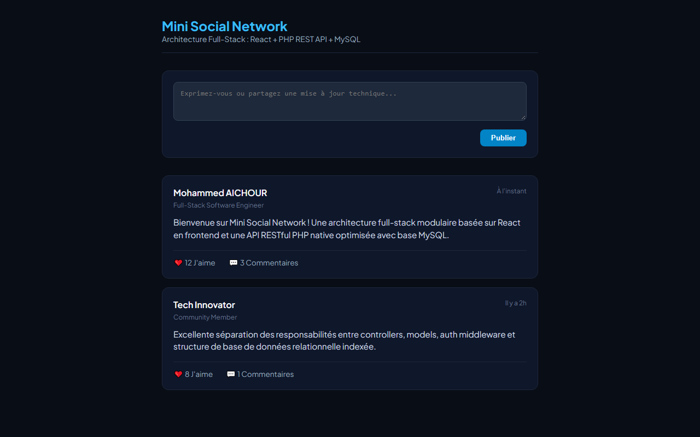
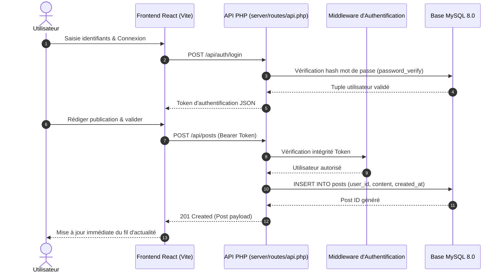
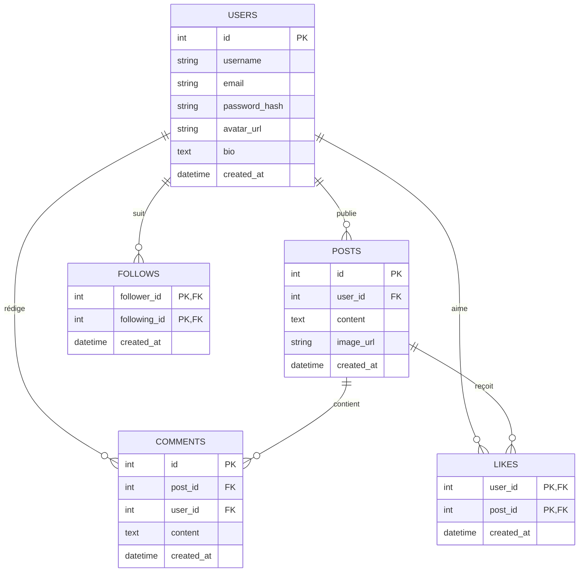

# Mini Social Network — Full-Stack Architecture

> **Architecture, Design & Engineering by Mohammed AICHOUR**  
> *Full-Stack Software Engineer & Solutions Architect*

[](https://www.php.net/)
[](https://www.mysql.com/)
[](https://react.dev/)
[](#)

<p align="center">
  
</p>

---

## 📌 Présentation du Projet

**Mini Social Network** est une architecture full-stack modulaire conçue pour offrir les fonctionnalités essentielles d'un réseau social moderne avec une séparation stricte des responsabilités (Separation of Concerns) et une performance optimale.

Le projet combine :
1. **Frontend moderne** : Application React réactive pour l'interaction utilisateur et le flux en temps réel.
2. **Backend RESTful** : API en PHP natif orientée objet (PDO, MVC / Controller-Model, Middleware d'authentification).
3. **Persistance relationnelle** : Base MySQL relationnelle normalisée (3NF) avec clés étrangères en cascade et index optimisés pour la recherche rapide.

---

## 🏗️ Structure du Projet

```text
mini-social-network/
│
├── client/                     # Application Frontend React
│   ├── src/
│   │   ├── App.jsx             # Flux d'actualités & publication
│   │   ├── index.css           # Thème & typographie
│   │   └── main.jsx            # Point de montage DOM
│   ├── index.html
│   └── package.json
│
├── server/                     # API RESTful Backend (PHP)
│   ├── config/
│   │   └── database.php        # Singleton de connexion PDO MySQL
│   ├── controllers/
│   │   ├── AuthController.php  # Authentification & tokens
│   │   ├── UserController.php  # Profils utilisateurs
│   │   ├── PostController.php  # CRUD publications & flux
│   │   ├── CommentController.php # Commentaires liés
│   │   └── FollowController.php  # Relations d'abonnements
│   ├── models/
│   │   ├── User.php            # Requêtes SQL utilisateurs
│   │   ├── Post.php            # Requêtes SQL publications
│   │   ├── Comment.php         # Requêtes SQL commentaires
│   │   └── Follow.php          # Requêtes SQL follows
│   ├── middleware/
│   │   └── authMiddleware.php  # Vérification Bearer token
│   ├── routes/
│   │   └── api.php             # Routeur HTTP RESTful
│   ├── uploads/                # Stockage des médias utilisateurs
│   ├── index.php               # Point d'entrée de l'API & CORS
│   └── .env.example            # Configuration d'environnement
│
├── database/
│   └── schema.sql              # Schéma SQL DDL normalisé
│
└── tests/
    └── test_architecture.js    # Suite de tests automatisés d'intégrité
```

---

---

## 📡 Points d'Accès de l'API RESTful (PHP)

| Méthode | Route | Contrôleur / Action | Authentification |
|---|---|---|---|
| `POST` | `/api/auth/register` | `AuthController@register` | Publique |
| `POST` | `/api/auth/login` | `AuthController@login` | Publique |
| `GET` | `/api/posts` | `PostController@index` | Bearer Token |
| `POST` | `/api/posts` | `PostController@store` | Bearer Token |
| `GET` | `/api/posts/{id}` | `PostController@show` | Bearer Token |
| `POST` | `/api/posts/{id}/comments` | `CommentController@store` | Bearer Token |
| `POST` | `/api/users/{id}/follow` | `FollowController@toggle` | Bearer Token |

---

## 🏛️ Architecture & Modèle Relationnel

### Diagramme de Séquence : Flux d'Authentification & Publication



### Schéma Entité-Association (ERD)



---

## 🚀 Démarrage Rapide

### 1. Base de Données
Importez le schéma dans votre serveur MySQL :
```bash
mysql -u root -p < database/schema.sql
```

### 2. Démarrage de l'API Backend
```bash
cd server
php -S localhost:8000
```

### 3. Démarrage du Client Frontend
```bash
cd client
npm install
npm run dev
```

---

## 🧪 Tests Automatisés

Pour valider l'intégrité architecturale :
```bash
node tests/test_architecture.js
```

---

## 👨‍💻 Concepteur & Développeur

**Mohammed AICHOUR**  
- GitHub : [@Mohammed-aichour](https://github.com/Mohammed-aichour)  
- Profil & Portfolio : Intégré au portfolio professionnel officiel.
